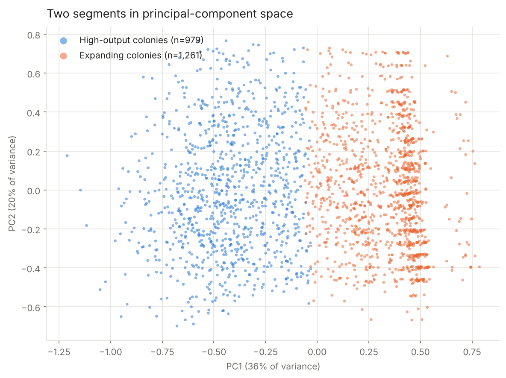
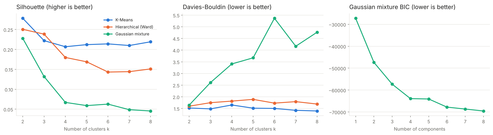
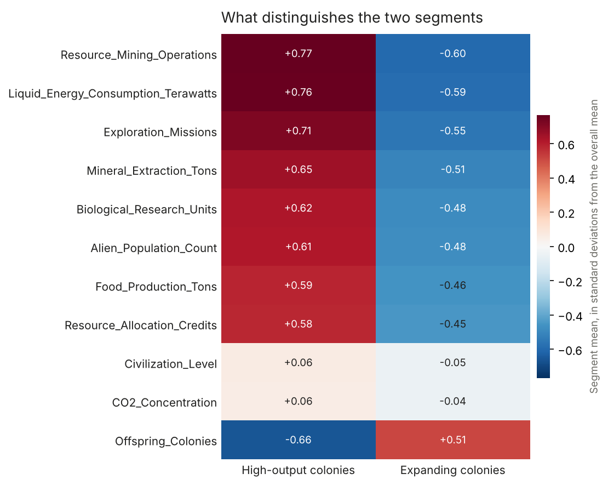

# Comparative Evaluation of Clustering Methods: Imputation, Model Selection and Stability

**Research question:** Do the 2,240 colonies in the dataset form distinct groups, and which clustering method recovers them most reliably?

**Completed:** January 2025, revised November 2026 · **Data:** 2,240 colonies, 34 attributes, ~10% missing values · **Methods:** KNN imputation, variance and correlation screening, K-Means, Ward hierarchical clustering, Gaussian mixtures, DBSCAN, bootstrap stability



> **Key findings**
> - The colonies split into **two segments** that every method recovers: **high-output colonies** (44%), with 7–9 times the production, research and energy use, and **expanding colonies** (56%), with low output but most of the offspring colonies.
> - **K-Means with k = 2** is the most reliable model: best silhouette (0.28) and Calinski-Harabasz score, and nearly identical partitions on bootstrap resamples (ARI 0.97, against 0.68 for Ward).
> - **Preprocessing mattered more than the algorithm.** One near-constant feature created a fake 96-colony cluster that made DBSCAN look like the best model in the first version of this study. Without it, DBSCAN finds a single dense cloud.

**Stack:** Python · scikit-learn · pandas · NumPy · matplotlib

---

## Context

Clustering is often judged by picking a model and a silhouette score. This study instead treats every step as a choice to be tested: how to fill missing values, which features to keep, how many clusters to look for, and whether the answer survives resampling. It's a revision of a group project from January 2025, rebuilt as a reusable pipeline with each decision measured rather than assumed.

The dataset's structure (2,240 records, an education-style ordinal level, counts of dependants) mirrors a well-known retail customer-segmentation dataset, so the same workflow transfers directly to customer segmentation.

## Method

**1. Imputation, benchmarked.** Only 77 of 2,240 rows are complete, so dropping rows isn't an option. Four imputers were scored by hiding 5% of observed values and reconstructing them:

| Method | RMSE (SD units) | MAE |
|---|---:|---:|
| **KNN, k = 10** | **0.872** | **0.544** |
| KNN, k = 5 | 0.896 | 0.551 |
| Mean | 1.006 | 0.738 |
| Median | 1.070 | 0.655 |

**2. Feature screening.** After removing identifiers and dates, four features where a single value covers more than 92% of colonies were dropped, then correlated pairs (|r| ≥ 0.45) were inspected to keep 11 features covering production, energy, population and expansion.

**3. Model selection.** K-Means, Ward hierarchical clustering and Gaussian mixtures were fitted for k = 2–8 and scored on silhouette, Calinski-Harabasz and Davies-Bouldin.



All three methods peak at k = 2. Silhouette stays below 0.3 at every k: the segments are real but overlap, as is typical for continuous socio-economic data.

**4. Density check.** DBSCAN's `eps` was set from the k-distance curve and varied on a grid. Below `eps` ≈ 0.28 most colonies become noise; above it, everything merges into one cluster. There are no separate dense regions, only one continuous population that the partitioning methods divide.

**5. Stability.** Each method was refitted on 30 bootstrap resamples and compared with the full-data partition:

| Method | Mean ARI | SD |
|---|---:|---:|
| **K-Means** | **0.97** | 0.02 |
| Gaussian mixture | 0.94 | 0.05 |
| Ward hierarchical | 0.68 | 0.10 |

## The two segments



| | High-output colonies | Expanding colonies | Ratio |
|---|---:|---:|---:|
| Share of colonies | 44% | 56% | |
| Food production (tons) | 52.4 | 5.9 | 8.9× |
| Biological research units | 75.5 | 8.9 | 8.5× |
| Mineral extraction (tons) | 326.7 | 40.9 | 8.0× |
| Energy consumption (TW) | 589.8 | 81.8 | 7.2× |
| Exploration missions | 5.0 | 0.9 | 5.9× |
| Offspring colonies | 0.05 | 0.76 | 0.07× |

CO₂ concentration and civilization level barely differ between the two: the split is economic, not environmental or developmental.

## What changed from the first version

| | Original (January 2025) | This revision |
|---|---|---|
| Imputation | KNN, k = 5, chosen without comparison | Four methods benchmarked on masked values; KNN k = 10 |
| Feature screening | By eye from histograms | Rule-based (dominant-value share > 90%); removes a near-constant feature the original kept |
| Model comparison | Elbow and silhouette for K-Means only; silhouette counted noise points | k = 2–8, three indices, noise excluded |
| Best model | DBSCAN (silhouette 0.35) | K-Means, k = 2: DBSCAN's result traced to an artefact |
| Robustness | Not tested | Bootstrap stability and cross-method agreement |
| Visualisation | First two raw features | Principal components and standardized segment profiles |
| Code | One notebook | Modules in `src/` with unit tests, notebook as report |

## Limitations

- Internal indices measure geometry, not usefulness. Without labels, the segments should be validated against an external outcome.
- KNN imputation assumes values are missing at random.
- Min-max scaling gives the ordinal civilization level the same weight as continuous features.

## Reproducibility

```bash
pip install -r requirements.txt
pytest                                # unit tests
jupyter notebook clustering_study.ipynb
```

The dataset was provided for the course and isn't included. Place `alien_galaxy.csv` in `data/` to run the notebook (about 20 seconds). Seeds are fixed throughout.

```
├── clustering_study.ipynb   full study with outputs
├── src/
│   ├── preprocessing.py     encoding, imputation benchmark, screening, scaling
│   ├── models.py            model sweep, DBSCAN grid, bootstrap stability
│   └── plots.py             figures
├── tests/                   unit tests (pytest)
├── images/                  figures used in this README
├── docs/                    original 2025 report
└── requirements.txt
```

---

<sub>Francesca D'Aloia Cascone. Revised from a group project for the AI and Machine Learning course at LUISS Guido Carli (January 2025).</sub>
